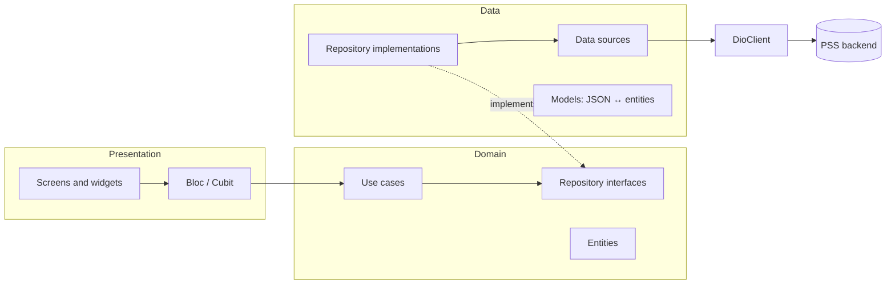
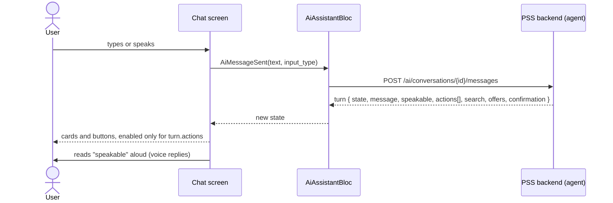

# PSS Mobile

> A Flutter app for booking airline tickets end to end: search, book, add-ons, pay, check in. It includes an **AI assistant** you can talk to or type to, built on top of the [PSS backend](https://github.com/adityaputra42/pss_modular_cqrs).


<!--
Add screenshots here before publishing, for example:
| Search | Flight results | Booking | AI assistant |
| --- | --- | --- | --- |
|  |  |  |  |
-->

## Features

- **Accounts.** Sign up, sign in, automatic token refresh, and guest use.
- **Flight search.** One-way and round-trip, airport selection, results with fares.
- **Booking.** Passenger and contact details (adults, children and infants), add-ons (baggage, meals, seats) with purchase and cancellation, seat selection.
- **Payment.** Pays through the backend's DOKU virtual-account flow; booking history and detail.
- **Check-in and boarding pass.**
- **Wallet.** Balance, top-up with status tracking, and transaction history.
- **Notifications.** Firebase Cloud Messaging with local notifications.
- **Profile and settings.** Profile editing and a persisted light/dark theme.
- **AI assistant.** Describe a trip in a sentence ("Jakarta to Bali on 24 December, 2 adults and 1 infant"), pick a flight from cards, fill in passengers in a form, confirm with a button, and pay by virtual account or wallet balance. Works by text or voice.

## Architecture

The app uses **Clean Architecture per feature**, **BLoC/Cubit** for state, **get_it** for dependency injection and **go_router** for navigation. Failures are values, not exceptions: use cases return `Either<Failure, T>` (`fpdart`).



**The dependency rule.** Presentation depends on domain, data depends on domain, and domain depends on nothing. Entities are plain Dart; JSON lives only in models. That keeps business rules testable without Flutter or a network.

**One flow, end to end** (flight search as an example):
screen dispatches an event → bloc calls a use case → the use case asks a repository interface → the repository implementation calls a remote data source → `DioClient` calls the API → a model parses the JSON → it is mapped to an entity → the repository returns `Right(entity)` or `Left(Failure)` → the bloc emits a state → the screen rebuilds.

### Folder structure

```text
lib/
├── main.dart                 bootstrap: Firebase and dependency injection
├── app/
│   ├── init_dependencies.dart   get_it registrations, one _initX() per feature
│   ├── routes/                  go_router configuration and route names
│   └── theme/
├── core/
│   ├── common/                  shared cubits, entities and widgets
│   ├── constants/               endpoints and environment (envied)
│   ├── error/                   Failure types
│   ├── network/                 DioClient, interceptors, error handling
│   ├── usecase/                 UseCase<Success, Params> base
│   └── utils/                   preferences, speech-to-text, text-to-speech, snackbars
└── features/
    ├── AiAssistant/  auth/  flight/  home/  main/  master/  notifications/
    └── onboarding/  profile/  setting/  splash/  ticket/  wallet/
        └── (each data-driven feature)  data/ · domain/ · presentation/
```

### Design decisions

| Decision | Why |
| --- | --- |
| `Either<Failure, T>` from use cases | Errors are part of the signature, so no screen forgets to handle one and none depends on a thrown exception type. |
| `UseCase<Success, Params>` base class | One shape for every operation; easy to fake in tests. |
| DI split per feature (`_initAuth`, `_initFlight`, …) | A feature's wiring lives in one place and can be read in isolation. |
| Bloc for flows, Cubit for simple state | Events make multi-step flows (booking, AI chat) traceable; a Cubit is enough for a theme toggle. |
| Auth-aware HTTP client | See below. |
| Environment via `envied` | Separate dev, staging and production base URLs chosen at build time. |

### Networking

`DioClient` attaches the bearer token, and when several requests fail with `401` at the same time it refreshes the token **once** (a single in-flight refresh shared by all of them), retries each failed request a single time, and signs the user out if the refresh token is no longer valid. Sessions without a refresh token are treated as guests rather than as errors.

## AI assistant

The assistant is a thin client over the backend agent. The server owns the conversation state and decides what the user may do next; the app renders it.



- **Server-driven UI.** Buttons are enabled from the `actions` list of the latest turn, never from guesses on the client. The booking and payment confirmations are buttons bound to a server hash; saying "yes" in chat does nothing.
- **Voice.** Speech-to-text fills the input live and sends the final transcript as `voice_transcript`; replies are read aloud from the server's `speakable` text. The microphone is released before the speaker starts, so the assistant never transcribes itself. A full-screen overlay shows listening (level-reactive) and a compact banner shows speaking without blocking taps.
- **Passenger form.** The form is sized from the server's validated search (`search.passengers`: how many adults, children and infants), and mirrors the server's age rules against the first and last travel date. The date picker only offers birth dates the server will accept.
- **Fallback.** When the assistant is unavailable the app offers the regular booking form.

## Tech stack

| Area | Packages |
| --- | --- |
| State management | `flutter_bloc`, `bloc`, `equatable` |
| Dependency injection | `get_it` |
| Navigation | `go_router` |
| Networking | `dio`, `internet_connection_checker_plus` |
| Functional error handling | `fpdart` |
| Config | `envied` (+ `build_runner`) |
| Push and local notifications | `firebase_core`, `firebase_messaging`, `flutter_local_notifications` |
| Voice | `speech_to_text`, `flutter_tts` |
| Storage | `flutter_secure_storage` |
| UI | `animations`, `animate_do`, `shimmer`, `paged_vertical_calendar`, `timelines_plus`, `dropdown_button2`, `top_snackbar_flutter`, `loader_overlay` |
| Device and formatting | `device_info_plus`, `package_info_plus`, `intl` |

Dart SDK `^3.13.0` (see `pubspec.yaml`).

## Getting started

### Prerequisites

- A Flutter SDK matching `environment.sdk` in `pubspec.yaml`
- A running [PSS backend](https://github.com/adityaputra42/pss_modular_cqrs) (the Docker stack is the easiest way)
- A Firebase project for push notifications

### Setup

```bash
git clone <this repository>
cd pss_app

cp .env.example .env              # set the backend URL(s), see below
flutter pub get
dart run build_runner build --delete-conflicting-outputs   # generates the envied config
```

Add your own Firebase files (they are specific to your project):

- `android/app/google-services.json`
- `lib/firebase_options.dart`, generated with `flutterfire configure`

Then:

```bash
flutter run
```

### Configuration

| Key | Meaning |
| --- | --- |
| `APP_ENV` | `dev`, `staging` or `prod`: which base URL the app uses |
| `DEV_URL`, `STAGING_URL`, `PRODUCTION_URL` | Backend base URL per environment (include `/api/v1`) |
| `APP_USERNAME_LOGIN`, `APP_PASSWORD_LOGIN` | Demo account prefilled on the sign-in screen outside production, a development convenience |

On the Android emulator the host machine is `10.0.2.2`, so a local backend is typically `http://10.0.2.2:8000/api/v1`.

`envied` obfuscation makes values harder to read in the binary, but it is not encryption. Do not put real secrets in `.env`, and do not commit the generated `environment.g.dart` if it contains anything you would not publish.

### Voice permissions

Voice needs the microphone and speech recognition: `RECORD_AUDIO` and the speech-recognizer and TTS `<queries>` on Android, and `NSMicrophoneUsageDescription` plus `NSSpeechRecognitionUsageDescription` on iOS. All of these are already in the manifest and `Info.plist`.

## Testing

```bash
flutter analyze
flutter test
```

Current tests cover the AI assistant's passenger rules (age windows and field validation, mirroring the backend) and its passenger-step completion logic. Coverage of use cases, blocs and widgets is still thin and is the next thing to grow.

## Roadmap

- [x] Clean Architecture with BLoC, get_it and go_router
- [x] Booking, add-ons, payment, wallet, check-in
- [x] Push notifications
- [x] AI assistant with voice input and spoken replies
- [x] Store tokens in secure storage
- [ ] Widget and bloc test coverage
- [ ] Wallet payment in the regular checkout (the AI checkout already offers it)
- [ ] Localization (strings are currently mixed Indonesian and English)

## Author

**Aditya Putra Pratama** · [@adityaputra42](https://github.com/adityaputra42)
